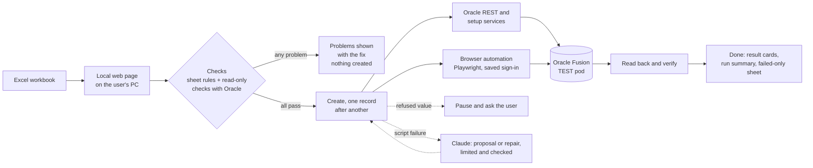

# Configuration Automation: architecture overview

## 1. Purpose

This project sets up Oracle Fusion Order Management from one Excel workbook. A consultant fills in the workbook and
uploads it to a small web page on their own PC. The page checks every row against Oracle first. It then creates
everything in Oracle and reads it back to confirm. The goal is to replace hours of manual clicking with one checked,
repeatable run that never leaves half-made setup behind.

## 2. The big picture

## 3. The main parts

- **Page** (`page/`): the local web page. It handles upload, checks, the run queue, progress, questions and results.
- **Sheet** (`sheet_definition.json`, `sheet_registry.json`): defines every tab and column and which folder handles each tab. Adding a tab mostly means editing these files.
- **Customers**: creates organization and person customers by filling Oracle's form in a browser.
- **Order Types**: adds order types (codes in an order lookup type) through REST.
- **Payment Terms**: creates payment terms through Oracle's setup import, driven in a browser.
- **Lookup Types**: creates lookup types through the setup import and adds codes through REST.
- **Business Units**: creates the business unit through the setup import and adds data access through REST.
- **Price Lists**: creates and approves price list headers and access sets through REST.
- **Shared code** (`common/`): sign-in, environment safety, browser helpers (including the retry helper) and the page contract every folder follows.
- **Tests**: an offline behaviour matrix (`page/matrix/`) and a Customers regression check with frozen snapshots (`_frozen/`).

## 4. The run flow

1. **Upload.** The user picks the workbook. The page reads it locally, with no Claude involved.
2. **Check.** First the sheet rules: required fields, formats, dates and links between tabs. Then read-only checks
   with Oracle: lists, places, existing names, and each module's own plan. Problems appear in red with the fix.
3. **Create.** Allowed only when every check passes. Records go one at a time, in a fixed module order. Each is
   created, then read back from Oracle.
4. **Done.** Result cards are grouped by module, followed by a run summary (time, results, repairs and cost). A
   sheet holding only the failed rows can be downloaded.

**Rule:** nothing is created unless the whole sheet passes the check.

## 5. Routes and fallbacks

| Module | Main route | Status |
|---|---|---|
| Price Lists | REST | Proven (header and access sets; no lines yet) |
| Order Types | REST; fallback: setup export and import in a browser | REST proven; fallback not re-proven on the classic page |
| Lookup Types | Setup import plus REST for codes | Proven; the sheet's Create not yet run in Oracle |
| Payment Terms | Setup import driven in a browser | Proven; the sheet's Create not yet run in Oracle |
| Business Units | Setup import in a browser, access by REST | Proven, fast run about 40 s |
| Customers | Browser form fill (REST cannot create a whole customer) | Proven, about 3 minutes per customer |

The fallback layers, from cheapest to most expensive:
1. **Retry:** every browser step is checked and tried up to 3 times. Save and Submit are never retried.
2. **Automatic re-run:** a read-only check that could not run is run up to 2 more times, 20 s apart.
3. **Claude proposal:** for a refusal no rule recognises, Claude suggests one value. The user decides.
4. **Claude repair:** for a script failure, Claude fixes that one folder within strict limits ($2 per attempt, at
   most 5 attempts and 20 minutes). The server reviews the change before it reruns.

## 6. Safety rules

- Nothing is created unless the check is sure. A record is never left half-made.
- The automation never deletes or changes existing Oracle records. Existing records are skipped.
- It works on the test pod. Production is refused unless the user explicitly allows it in their own settings file.
- Claude never sees or types the sign-in details.
- When Oracle refuses a value, the run pauses and asks the user. The choices are a suggested value, a typed value,
  or skipping the record.
- A typed value is checked against Oracle before it is used.

## 7. Quality

- **Offline behaviour matrix:** 48 cases (6 modules x 8 behaviours), plus 12 cases for a check that cannot run.
  All pass. Nothing is sent to Oracle or Claude, and it takes about a minute.
- **Customers regression check:** frozen snapshots. The current code must build exactly the same preview as the
  approved version. It passes.
- **Testing backlog:**
  - checks of a 100-customer sheet;
  - a busy-machine stress run;
  - real sheet Creates for Payment Terms and Lookup Types;
  - the Order Types and Business Units fallback routes on the classic page;
  - AutoInvoice Grouping Rules (Receivables, built offline 2026-11-01): the first live run on the test pod. It must
    prove the no-browser setup import for this task, replace the STAND-IN file layout with the pod's real one, and
    list the grouping characteristics the pod's rules use. Then one Corsair rule is created, read back and skipped
    on a rerun;
  - Receivables sheet test (2026-11-02): workbook A ran the four Receivables modules together on the test pod (dependencies held, read back as sent, rerun skipped); still to do: the user's own run of workbook B on their page, and a sheet whose dependency fails on the real pod. Done 2026-11-02 (user's go-ahead): a sheet whose modules all have registry `"uses_browser": false` (the four Receivables modules) no longer checks the browser sign-in at upload or Create (`server.needs_signin()`, matrix "Sign-in gate" 3 of 3). Still open: the page's start-up checklist asks for the sign-in on every start, whatever the sheet;
  - the dependency rule across areas: a Receivables module that needs a business unit from the Order Management
    side (Receipt Sources, later);
  - Transaction Sources (built offline and checked read-only on the test pod 2026-11-01): the first live Create, with a
    Manual source with a neutral ZZ_TEST_ name first; then an Imported source with a grouping rule (its grouping rule
    field is outside FSCR's evidence); then one upload holding a grouping rule and a source that names it, so the
    rule is created first on the real pod.
  - Transaction Types (header only, built 2026-11-02; first live Create done 2026-11-02 with ZZ_TEST_TT_6421, an
    Invoice without a payment term: the route works and Post to GL Yes without accounts is accepted): next a type
    with an existing payment term; then one upload
    holding a Receivables payment term and a type that names it. Later: wire Transaction Sources' default
    transaction type to this module (needs `depends_on` as a list, a shared-code addition), and the accounting
    fields only with the user's explicit go-ahead (they can create account combinations in the pod's ledger).

## 8. Current status and honest limits

- All six modules work end to end on the test pod through the page.
- The latest proof: the sample workbook (19 records, six modules) was checked 14 times in a row. Every run was
  ready in about 3 minutes.
- **Slow:** Customers are made in a browser, about 3 minutes each. 100 customers would take about 5 hours to
  create. The check time for 100 customers is not yet measured (5 customers took about 3 minutes).
- **Not yet proven:** price list lines and items; the classic-page fallbacks for Order Types and Business Units;
  the 100-customer check.
- One run at a time. One Oracle browser at a time, to avoid lost clicks.

## 9. Suggested slides

1. **Why:** manual Oracle setup is slow and error-prone; one workbook replaces hours of clicking; every result is
   read back from Oracle.
2. **How it works:** upload, check, create, done; nothing is created unless everything passes; one page for six
   kinds of setup.
3. **Under the hood:** REST where Oracle allows it, a browser where it does not; shared safety code; each module
   lives in its own folder.
4. **Safety and recovery:** no deletes, never half-made, test pod only; it pauses and asks on a refused value;
   retries, re-runs and a limited Claude repair.
5. **Status and next steps:** all six modules proven on the test pod, 48 of 48 behaviour tests pass; next comes
   the large-sheet speed for Customers and the remaining proofs.
