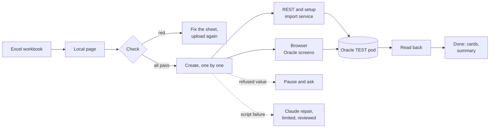

# Presenter briefing: Oracle Order Management Configurator Automation Tool

Written 2026-10-27, read-only, from the project's notes, code and page logs. "Proven" here means one of two things.
Either the record was created for real in the Oracle TEST pod and read back, or the rule is enforced in code.
Anything else is called an estimate or "not proven".

Two notes before you start:
- **The deck is not in the project.** Corsair_OM_Configurator_Automation_Tool.pptx was not found, so I could not
  check it slide by slide. Point 15 compares the facts against your slide titles instead.
- **The word "Corsair" is not in the project.** The demo workbook with 14 records in the logs is
  `Kingston_demo_fixed.xlsx`. This briefing calls it "the Kingston demo" and treats it as your use case.

---

## 1. The 2-minute story

- **What it is.** A small web page on the consultant's own PC. It sets up Oracle Fusion Order Management from one
  Excel workbook.
- **The problem.** Setting up customers, order types, payment terms, lookups, business units and price lists by
  hand means hours of clicking. Mistakes surface late, and people forget what they already made.
- **How it works.** Four stages.
  - **Upload:** you pick the workbook.
  - **Check:** every row is checked against the sheet's rules and, read-only, against Oracle. All problems are
    shown at once, with the fix.
  - **Create:** creates every record, one after another, and reads each one back from Oracle.
  - **Done:** shows a result card per record and a run summary. You can download a sheet with only the failed rows.
- **The one rule.** Nothing is created unless the whole sheet passes the check. The Create button stays off while
  anything is red.

## 2. How each part works

### The web page and its run queue
- A small local server (`page/server.py`) on 127.0.0.1, port 8765. It is not on the network.
- The page has four screens: Upload, Check, Create, Done.
- **One run at a time.** A run is queued, and records go one after another in a fixed module order.
- **One Oracle browser at a time.** Since 2026-10-26 the preview's checks, an answer's check and a run never use
  Oracle side by side.
- At every start the page runs a setup checklist: packages, browser, the Oracle details file, the Oracle
  connection and the saved Oracle sign-in. Claude's tool is optional.

### The Excel workbook
- There is one tab per kind of setup, plus child tabs for repeating rows:
  - Address Purposes for customers;
  - Payment Term Lines and Payment Term Sets for payment terms;
  - Lookup Codes for lookup types;
  - Price List Access Sets for price lists.
- There is also a Read me tab and a hidden Lists tab. The Lists tab holds drop-down values that contain a comma,
  for example "Yaqub, Younas".
- The page makes the empty workbook itself:
  - row 1 is the sections, row 2 the labels (yellow = required, blue = optional), row 3 the hints;
  - drop-downs run on rows 4 to 500;
  - some drop-downs are Oracle's live lists, read when the sheet is made (for example locations and sets).
- **Sheet definition** (`sheet_definition.json`): every tab and column, its type, whether it is required, its
  drop-down values and the key it maps to.
- **Sheet registry** (`sheet_registry.json`): which module folder handles which tabs, how child rows join their
  parent, and the limit of 100 records per module per upload. It also names each module's read-only check and
  whether Create sends records one by one or in one batch.
- Child rows join their parent by name. Customers ignore capitals and extra spaces. Payment terms, lookup types and
  price lists use the exact name, which is Oracle's own rule.

### The six modules

| Module | What it creates | Route | Why that route |
|---|---|---|---|
| Customers | Organization or person customer: party, one account, one site with address and purposes | Browser form fill (Playwright) on Create Customer | REST cannot create a whole customer (account, site, address set, purposes, Supplier Site ID), and the setup export/import is disabled for this task |
| Order Types | New codes in the order type lookup (ORA_DOO_ORDER_TYPES) | REST; fallback: setup export/import in the browser | REST works for lookup codes |
| Payment Terms | Payment terms with installments, discounts and set assignments | Setup CSV export/import, driven in the browser | No REST route was used; the setup import is proven |
| Lookup Types | New lookup types with codes, and new codes on existing types | Setup CSV import through REST (no browser); REST for codes on existing types; the browser only to look up a module's name | The import creates whole types; REST adds codes |
| Business Units | Business unit, plus Order Manager and Pricing Administrator access for Configuration.TEST | Setup CSV import through REST since 2026-10-26 (browser screens as fallback); access by REST | REST cannot create a business unit, but the setup import service can |
| Price Lists | Price list header, access sets, approval | REST end to end | REST does all of it |

**Customers**
- **How it checks:**
  - the places (State, City, Postal Code) through the same dialogs Create uses, on an unsaved form left with Cancel;
  - the lists;
  - same-name customers already in Oracle.
- **Time:** about 3 to 5 minutes per customer (measured, see point 10).
- **Rules we found:**
  - names are not unique in Oracle;
  - Oracle's "Matching Organizations" warning is always answered with "Create new";
  - Ship to needs Bill to;
  - Bill-to Site must be the customer's own address;
  - a city name that starts other city names (DALLAS, SEATTLE) must be picked by its columns, not typed.

**Order Types**
- **How it checks:** the code must not exist yet; the meaning must be unique within the type.
- **Time:** about 30 to 40 s each through the page (measured).
- **Rules we found:**
  - the code is case-sensitive, at most 30 characters;
  - the meaning is at most 80 characters;
  - "today" means Oracle's today minus one day, read from Oracle and never from the PC.
- **Watch out:** a lookup code alone may not make a complete order type. Transaction types, assignment rules and
  sequences are separate, not-built steps.

**Payment Terms**
- **How it checks:** every rule in the notes, Oracle's Calendar and Set Code lists, and the existing names.
- **Time:** about 2.5 minutes per import for 1 to 13 terms.
- **Rules we found:**
  - the name is exact (capitals and spaces count), at most 50 characters;
  - percent installments total exactly 100;
  - a term is all percent or all amount;
  - an amount term's last line is 0;
  - Day of Month needs Months Ahead (0 is allowed);
  - Rank is unique across all payment terms;
  - discount percent must be above 0;
  - the second discount must be lower than the first.
- One bad term in an import does not block the others. Oracle saves the good ones and the log names the bad one.

**Lookup Types**
- **How it checks:** the type exists or not, a System type is refused, module names are looked up, and the meaning
  is unique.
- **Rules we found:**
  - Oracle drops the WHOLE type when one of its code rows is refused;
  - the order type lists are reserved for the Order Types tab.

**Business Units**
- **How it checks:** the name exists (also when only capitals differ), location, default set, manager, and the
  access user and roles.
- **Time:** about 40 to 55 s for one; 3 together took 81 s in the Kingston demo.
- **Rules we found:**
  - leading or trailing spaces in the name make a SECOND business unit in Oracle, so the tool refuses them;
  - a capitals-only duplicate makes Oracle drop everything sent with it;
  - the manager can only be "Yaqub, Younas" or "Smith, Aron" (pod-specific);
  - the access is always for Configuration.TEST (fallback Configuration).

**Price Lists**
- **How it checks:** currency, business unit, sets and dates.
- **Time:** seconds; 3 took 17 s in the Kingston demo.
- **Rules we found:**
  - a price list cannot be approved without at least one access set;
  - dates are stored in UTC and shown in the Oracle user's time zone;
  - a price list for a business unit on the same sheet waits until that business unit is created.
- **Out of scope:** items and lines.

## 3. The Check stage
- **The sheet rules first, no Oracle needed:** required fields, types, dates, start before end, child rows linked to
  a parent, names listed twice.
- **Then read-only checks with Oracle, one after another:**
  - Oracle's live lists;
  - existing names (Customers' same-name search);
  - Customers' places;
  - each module's own `--plan` check: every rule plus Oracle's current data.
- All problems are shown at once, in red, each on its sheet row with the fix. Problems only clear after you fix the
  sheet in Excel and upload it again.
- Create stays off while any red remains.
- A check that cannot run is re-run up to 2 more times, 20 s apart. If it still fails, the preview stops with the
  real reason under "Oracle" and nothing is created.
- **What can still fail only at Create** (the check cannot see it):
  - anything Oracle refuses only at save. Examples: a Payment Terms import log reason the tool doesn't know, a Lookup
    Types import refusal, a Customers message after Save, an Order Types REST error;
  - something someone else creates between the check and Create. Business Units re-reads the names just before
    sending.
  - Customers places that could not be confirmed at the check. These are marked "held" in yellow and checked again
    at Create.

## 4. The Create stage
- **Module order is the registry order:** Customers, Order Types, Payment Terms, Lookup Types, Business Units, Price
  Lists.
- **Business units come before price lists** because a price list may name a business unit from the same sheet. Such
  a price list waits. It is not sent if its business unit failed or was skipped.
- **Read-back:** every record is read back from Oracle and compared with what was sent. Only then does its card say
  "checked every value in Oracle".
- **Already there:** an existing record is skipped and never changed. This applies to an order type code, a payment
  term name (exact), a lookup type, a business unit (only missing access is added) and a price list.
- **Customers with an existing name (checked in the code):**
  - the customer is never skipped by name;
  - before saving, the tool lists the existing customers with that name;
  - after Save and Close Oracle shows "Warning: Matching Organizations" (or Persons), and the tool always picks
    Option 2, "Create new organization based on what you provided". Option 1 would tie the new account to someone
    else's customer;
  - the new customer gets its own new Registry ID, and the tool finds it by that ID, not by name;
  - the existing customers are not touched. Kingston demo, measured: "Created ... Microsoft with Registry ID 130964 ...
    1 other customer with this name (Registry ID 75379) was not touched."
  - a rerun of the same request after a save never makes a second one. The tool keeps a note of what it saved and
    verifies that customer instead.
- **A failed record does not stop the others.**

## 5. Pause and ask
- When Oracle refuses a value at Create, the run does not fail silently. The record gets a "Needs your decision"
  card, while the rest of the run carries on.
- The card shows Oracle's reason, the sheet row and field, and suggested values as buttons (for example SANTA CLARA
  and SAN JOSE for a refused city).
- You can pick a suggestion, type another value, or choose "Skip this one".
- A typed or picked value is first checked against Oracle, read-only. If Oracle would not accept it, the panel says
  why and stays open. Only then is that one record run again, never doubled.
- The questions are stored in the run, so a page refresh shows them again (proven).
- A skipped record goes into the failed-only sheet, with Oracle's reason as a note on the cell.
- This is on for all six modules.

## 6. Claude's role
- **The normal run uses no Claude.** Reading the sheet, the checks and Create are plain code. The run summary says
  "Claude was not used: 0 tokens, $0" when that is the case.
- **Claude proposal:** when Oracle refuses a value that no rule recognises, Claude suggests ONE field and value. It
  has read-only access to the folder's notes. The panel says "Claude suggests ... Nothing is changed until you
  choose." It is never applied by itself.
- **Automatic repair:** when a record fails for a script reason (not the user's data), Claude looks for the cause in
  that one module folder. It reads the log and the screenshot, and can look at the live screen read-only. It may
  edit only that folder.
  - **Limits:** $2 per attempt, at most 5 attempts and 20 minutes.
  - **Isolated:** no connectors, no Chrome extension, no questions to the user.
- **What the server reviews before it reruns:**
  - it compares the folder with a copy taken before the repair;
  - it refuses any added code line that touches the login file, the saved sign-in, environment settings, running
    other programs, new network connections, or deleting files;
  - if it refuses, it puts the files back and stops. Otherwise it reruns the same request itself, and the folder
    skips what already exists.
- **Repair does NOT start:**
  - for the user's own problems: a value Oracle refused, permission, production, setup needed, sign-in;
  - when something may already have been saved;
  - when Claude's tool is missing or not signed in;
  - for a failed preview check (repair is only for Create).
- **Measured cost:**
  - real repairs cost $0.67, $0.69, $0.78 and $1.20 (logged), all fixed on the first attempt;
  - an earlier proof cost $0.71 and $0.43;
  - one real proposal cost $0.50 (117,404 tokens);
  - the cap allows at most $10 for one repair (5 x $2). That has never been reached.

## 7. Reliability work: the lost-click problem
- **What we saw.** On 2026-10-26 the preview sometimes stopped with "couldn't be checked with Oracle just now (no
  answer)".
- **Cause.** The preview opened three Oracle browsers at once on one sign-in. Oracle's busy Setup page then accepted
  a click or a search Enter and ignored it. The old click helper only retried when Playwright itself raised an error,
  so a lost click was never noticed.
- **The fix:**
  - one Oracle browser at a time;
  - every browser step is checked and done again up to 3 times, with a short pause and a fresh wait, then one clear
    error naming the step. Save and Submit are never retried;
  - a check that cannot run is re-run up to 2 more times, 20 s apart;
  - the real failed step is shown on the page under "Oracle". "No answer" is gone.
- **The proof** (read-only, through the page's own check):
  - the 19-record sample workbook (six modules) was checked 14 times in a row. All were ready, in 180 to 213 s
    (average 192 s). No step needed a retry and no check needed a re-run;
  - a 5-customer sheet was ready after about 170 s of checking;
  - the 100-customer runs and a busy-machine stress test were NOT done (time limit).

## 8. Safety
- **No deletes.** The tool never deletes or changes existing Oracle records. Existing ones are skipped.
- **Never half-made:**
  - Business Units sends nothing unless all its checks pass, the access user and roles included;
  - a stop after Save says "may have been saved (Registry ID ...)" and a rerun never creates it twice.
- **Test pod only:**
  - every run prints the host and environment first;
  - production is refused in code unless the user themself sets ALLOW_PROD=yes;
  - browser work is refused on production even then;
  - production has never been used.
- **Sign-in:**
  - the user signs in once, in a visible window, and the session is saved on that PC;
  - Claude never reads the Oracle user name or password, never types them, and never opens the saved sign-in;
  - the repair review refuses any code that touches them.
- **Data:**
  - the login file, the saved sign-in and the logs stay on the PC and are never shared (SHARING.md);
  - the page listens only on 127.0.0.1;
  - Claude is only called for a proposal or a repair, with the folder's own notes and logs.

## 9. Testing
- **Offline behaviour matrix** (`page/matrix/test_matrix.py`, about 50 s, nothing sent to Oracle or Claude):
  - **48 cases** = 6 modules x 8 behaviours: answered with a suggestion, answered with a typed value, skipped, page
    refresh, forced script failure leading to repair, unknown refusal leading to a Claude proposal, unknown refusal
    with Claude not signed in, and a script failure in 1 of 2 records leading to repair;
  - **plus 12 cases** = 6 modules x 2: a check that cannot run (re-runs, then the real reason under Oracle, no run
    started) and a check that fails once (the re-run answers);
  - it runs the page's real server code, with the folder scripts and Claude replaced by stubs;
  - result: 48 of 48 and 12 of 12 PASS (2026-10-26).
- **Customers regression check** (`page/regression_customers.py`, about 2 s, offline):
  - frozen snapshots of the code (v1 and v2) and recorded Oracle answers for the 3-customer sample;
  - the current code must build the same preview, field by field (1415 values), and v1 versus v2 may differ only in
    the listed, intended way;
  - result: PASS;
  - **be aware:** the v2 snapshot was re-frozen on 2026-10-26 after later changes. Those include a Claude repair that
    edited the Customers code during a run that evening.
- **Real runs in the TEST pod, through the page:**
  - the Kingston demo, 14 of 14 created and verified, no repair, nothing asked;
  - a six-module run, 9 of 9 created, one automatic repair ($1.20);
  - the Customers v2 tests: 5 valid and 5 wrong customers, pause and ask, a forced stop after Save, places failing;
  - many earlier ZZ_TEST_ records per module.
- **Happy path proof:** the Kingston demo checked ready and created end to end (point 10).
- **NOT yet tested:**
  - a 100-customer sheet (neither the check nor Create);
  - a busy or slow machine;
  - Oracle's newer "Redwood" Setup layout since Oracle went back to the classic one (2026-10-21). Several folders
    still have Redwood code;
  - the Order Types fallback (export/import) on the classic layout;
  - the Business Units access fallback (export/import) on the classic layout;
  - a real Oracle refusal through Business Units' single-record route, and Oracle refusing a location or manager;
  - production, and any other pod or client;
  - price list items and lines (out of scope);
  - customers outside the United States through the new place path (other countries are typed, as before);
  - a sign-in that expires in the middle of a run (designed: a plain failure card; not seen in a test);
  - several users or PCs on the same pod at once;
  - the order type setup beyond the lookup code (transaction types, assignment rules and sequences are not built).

## 10. Numbers you can quote

| What | Number | Measured or estimate |
|---|---|---|
| Kingston demo: records | 14 (3 customers, 3 order types, 2 payment terms, 3 business units, 3 price lists) on 5 record tabs, plus 4 child tabs filled | measured (the workbook) |
| Kingston demo: check | 143 s (other uploads of it: 144 to 204 s) | measured |
| Kingston demo: whole Create | 18 min 45 s, no repair | measured |
| Kingston demo: 3 customers | 12 min 43 s (5:06, 3:49, 3:48) | measured |
| Kingston demo: 3 order types | 1 min 41 s | measured |
| Kingston demo: 2 payment terms (one import) | 2 min 43 s | measured |
| Kingston demo: 3 business units (together) | 1 min 21 s | measured |
| Kingston demo: 3 price lists (together) | 17 s | measured |
| Customers v2 test: 5 customers | 14 min 23 s (about 2.9 min each) | measured |
| Per customer | about 3 to 5 min | measured range |
| 100 customers, Create | about 5 to 7 hours (100 x 2.9 to 4.2 min) | estimate, never run |
| 100 customers, check | not measured | unknown |
| 19-record check (six modules) | 180 to 213 s, average 192 s, 14 runs | measured |
| 5-customer check | about 170 s | measured |
| Business unit, one | 37 to 55 s | measured |
| Payment terms import | about 2.5 min for 1 to 13 terms | measured |
| Six-module run | 9 records in 13 min 33 s, one repair | measured |
| Repair cost | $0.43 to $1.20 per repair, cap $2 per attempt | measured / enforced |
| Matrix | 48 + 12 cases, about 50 s | measured |
| Limit per upload | 100 records per module | enforced |

## 11. Limits and next steps
- **Speed of Customers:** a browser form, about 3 to 5 minutes each, one at a time. 100 customers is a half-day run
  (estimate). Faster would need a REST route Oracle does not offer for whole customers.
- **Open items:** everything in the "not yet tested" list in point 9.
- **Known gaps:**
  - some refusals only appear at Create (point 3);
  - pod-specific values are built in: the access user Configuration.TEST, the two managers, the place combinations
    proven;
  - one run and one Oracle browser at a time.
- **Planned improvements:** not in the project as a written plan. The notes only name the order type follow-up
  steps (transaction types, assignment rules, sequences) as "to be added later", and say that more per upload means
  raising the 100 limit.

## 12. Architecture in one paragraph
The user's workbook goes to a local web page. The page checks it with plain code and with read-only calls to
Oracle. When everything passes, the page runs each module's folder script one record after another. Each folder
uses the cheapest proven route: REST, Oracle's setup import service, or a browser that fills Oracle's own screens
with a saved sign-in. Each folder reads its records back and reports a plain result. Shared code handles sign-in,
environment safety and browser steps. Claude is only an optional helper for unknown refusals and script repairs,
under strict limits and a server review.

## 13. Tough questions

1. **Why not just use Oracle's own import (FBDI/FSM)?** We do use Oracle's setup import (the FSM CSV import) where
   it exists: Payment Terms, Lookup Types, Business Units. The tool adds what the raw import lacks: a check first,
   one workbook for six setups, the read-back and plain results.
   *Push:* FBDI is not used. For Customers the setup import is disabled in this pod.
2. **Why a browser and not only REST?** REST cannot create a whole customer. Payment terms run through the setup
   import screens.
   *Push:* where REST works, we use it: Price Lists, Order Types, Lookup codes, business unit access.
3. **Is it safe in production?** It has never been used there. Production is blocked in code, and browser work is
   refused on production entirely.
   *Push:* using it in production would need a decision, a test plan and an explicit setting by the user.
4. **What if Oracle changes its screens?** It already did, twice (Redwood on 2026-10-20, classic again on
   2026-10-21). Each folder was adapted.
   *Push:* a broken screen step fails clearly. The automatic repair can fix a selector inside the folder, reviewed
   by the server.
5. **What if it fails halfway?** Records are independent. A failed record doesn't stop the others. Each card says
   what was and wasn't saved. A rerun skips what exists.
   *Push:* Customers keeps a note of a saved customer, so a rerun never makes a second one.
6. **Can it delete or change existing data?** No. It only creates new records and skips existing ones.
   *Push:* the exception is Business Units, which adds missing access rows to an existing business unit, by design.
7. **How do you know it works?** Every record is read back from Oracle. Plus 60 offline behaviour cases, a frozen
   regression check, and real end-to-end runs.
   *Push:* the Kingston demo created 14 of 14 and checked every value.
8. **What does Claude do?** Nothing in a normal run. Only an optional proposal or repair when something fails.
   *Push:* a proposal is never applied without the user.
9. **What does Claude cost?** $0 in a normal run. Real repairs cost $0.43 to $1.20. The cap is $2 per attempt, 5
   attempts.
   *Push:* the cost is logged per run in the run summary.
10. **Can Claude break things?** It can only edit the one failing folder. The server checks the change for risky
    lines before it reruns.
    *Push:* it cannot touch the sign-in, the environment, other programs or deletes; the server puts the files back.
11. **How long for a real client?** Measured: 14 records in about 19 minutes; customers 3 to 5 minutes each.
    *Push:* 100 customers is an estimate of 5 to 7 hours, not measured.
12. **Who maintains it?** Not in the project. Each module is a self-contained folder with its own notes, so a new
    engineer can work on one module.
    *Push:* who owns it is a decision to make, not something the project records.
13. **Why Python and Playwright?** Not in the project as a written decision. Python runs the page without extra
    servers; Playwright drives a real browser with a saved sign-in.
    *Push:* say it was chosen, don't invent the reasons.
14. **Security of the sign-in?** The user signs in themself. The session stays on that PC. Claude never sees the
    password.
    *Push:* the session lasts about 4 to 8 hours in this pod, then the page asks for a new sign-in.
15. **Can other modules be added?** Yes. Copy the template folder, add the tab to the sheet definition and the
    registry. The page shows it without changes.
    *Push:* each new module still needs its own proof in Oracle.
16. **Other environments?** The host and environment are set in one file. Nothing is hard-coded to the pod.
    *Push:* but some values are pod-specific: the access user, the two managers, the proven places.
17. **What if two people run it at once?** Not tested.
    *Push:* one page runs one job at a time. Two PCs on one pod were never tried.
18. **What if the data is wrong?** The check shows every problem at once, with the fix. Nothing is created until all
    are fixed.
19. **What if Oracle refuses a value at Create?** The run asks you on the page, with suggestions, and checks your
    answer with Oracle first.
20. **Does it survive a page refresh?** Yes. The questions and progress live on the server (proven).
21. **Why is Customers slow?** It fills Oracle's form like a person and checks each value. About 3 to 5 minutes.
    *Push:* Oracle offers no REST route for a whole customer.
22. **Can it do 1000 records?** No. The limit is 100 per module per upload.
    *Push:* raising it is a setting, but larger volumes were never tested.
23. **What about price list lines and items?** Out of scope. Headers, access sets and approval only.
24. **Is an order type complete after this?** Not always. It adds the lookup code. Transaction types and rules are
    separate steps, not built.
25. **What if the sign-in expires mid-run?** The run ends with a plain card saying what was and wasn't created, and
    asks to upload again.
    *Push:* designed and coded, not seen in a test.
26. **What was the lost-click problem?** Three Oracle browsers at once made Oracle ignore clicks. Now it is one at a
    time, with every step checked and retried.
    *Push:* 14 of 14 checks were ready afterwards; the stress test is still to do.
27. **Is the check reliable?** In 14 runs in a row, all were ready with no retries.
    *Push:* a check that cannot run says why and creates nothing.
28. **What can the check not catch?** Refusals Oracle gives only at save, and changes someone makes between the
    check and Create.
29. **What happens to existing customers with the same name?** Untouched. A new customer with a new Registry ID is
    made. The page shows the existing ones first.
30. **Why not skip a customer whose name exists?** Customer names are not unique in Oracle, so the name is no proof
    the customer is the same one.
31. **Does it work on Redwood?** It was proven on Redwood on 2026-10-20. Oracle is back on classic, and Redwood is
    not re-proven.
32. **How do you prevent duplicates?** Exact name checks before sending, per-module rules, Business Units re-reading
    the names just before sending, and the Customers rerun note.
33. **What does it log?** Every step and result, with times, in local logs. Repairs are logged with tokens and cost.
34. **Can it run unattended?** Yes, once Create is pressed, unless a value is refused (then it waits for you), or the
    sign-in expires.
35. **What do you need from the client?** The filled workbook and a TEST pod user with the roles. The detailed list
    of required fields is in each module's notes.
36. **What is "proven" for you?** Created for real in the TEST pod and read back, or enforced and tested in code.
37. **Has it ever created something wrong?** Two customers were saved but reported "Nothing was saved" by an old
    version (v1). That was fixed in v2, which now searches Oracle before saying so.
38. **Who checks Claude's fix?** The server, automatically, against forbidden patterns. A person can review the
    change in the folder afterwards.
    *Push:* no human approval step before the rerun.
39. **What is the testing backlog?** 100 customers, a stress test, Redwood, the two classic fallbacks, production
    readiness, more pods.
40. **What happens with dates?** "Today" means Oracle's today minus one day (the user's rule), read from Oracle,
    never from the PC.
41. **What if the workbook has a tab it doesn't know?** It says "this tab isn't set up yet" and checks the rest.
42. **Can it change setup that already exists?** No. Existing records are skipped; a different value only gives a
    note.

## 14. One-page cheat sheet
- **What:** Excel workbook in, Oracle setup created and verified, through a local page.
- **Covers:** Customers, Order Types, Payment Terms, Lookup Types, Business Units, Price Lists.
- **The rule:** nothing is created unless the whole sheet passes the check.
- **Routes:**
  - REST: Price Lists, Order Types, Lookup codes, business unit access;
  - setup import service: Lookup Types, Business Units;
  - browser: Customers (form), Payment Terms (setup import screens).
- **Kingston demo (measured):** 14 records, check 143 s, Create 18 min 45 s, 14 of 14 created, no repair.
- **Customers:** 3 to 5 minutes each. 100 customers is about 5 to 7 hours (estimate).
- **Checks:** 19 records in about 3 minutes, 14 of 14 runs ready.
- **Safety:** no deletes, existing records skipped, never doubled, production blocked, Claude never sees the sign-in.
- **Pause and ask:** suggestions, a typed value checked against Oracle, Skip, survives a refresh.
- **Claude:** $0 in a normal run; repairs $0.43 to $1.20; cap $2 per attempt, 5 attempts, 20 min; server review.
- **Tests:** 48 + 12 offline cases PASS; Customers regression PASS; real runs in the TEST pod.
- **Not yet:** 100 customers, stress, Redwood re-proof, classic fallbacks, production, other pods, price list lines.

## 15. Things that may contradict the slides
I could not open the deck (not in the project). These are the facts that commonly differ from how this project is
described:
1. **The deck and the word "Corsair" are not in the project.** The 14-record workbook in the logs is
   `Kingston_demo_fixed.xlsx`.
2. **"About 9 minutes for 3 customers":** the Kingston demo measured 12 min 43 s for 3 customers (5:06, 3:49, 3:48).
   About 9 minutes matches the earlier v2 test pace (2.9 min each), not this demo.
3. **"5 tabs":** the demo fills 5 record tabs, but 9 tabs in all have rows (plus Address Purposes, Payment Term
   Lines, Payment Term Sets, Price List Access Sets), besides Read me and the hidden Lists tab.
4. **Business Units route:** `Method used.txt`, the top of the Business Units notes and my earlier
   ARCHITECTURE_OVERVIEW.md say "import in the browser". Since 2026-10-26 the code sends it through the setup import
   service by REST; the browser is only the fallback.
5. **Lookup Types route:** its import goes through the REST setup service, not the browser. The browser is used only
   to look up a module's name.
6. **"Sheet Create not yet run in Oracle" for Payment Terms and Lookup Types:** the root notes and my overview still
   say this, but the logs show both created through the page on 2026-10-26 (run 72d8292513).
7. **Order Types "about 1.5 minutes":** in the notes; through the page it measured about 30 to 40 s per order type.
8. **"Production-ready" or "works in production":** never used in production. Browser work is refused there in code.
9. **"Claude never changes code":** the automatic repair does edit the failing module's files (reviewed by the
   server). It happened in real runs (for example Customers on 2026-10-26).
10. **"Complete order types":** only the lookup code is created. Transaction types and rules are not built.
11. **"Full price lists":** headers, access sets and approval only, no items or lines.
12. **Inputs needed:** pod-specific values are built in. The access user is Configuration.TEST; the managers are only
    Yaqub, Younas and Smith, Aron. Customers need Name, Account Address Set and Supplier Site ID.
13. **Volumes:** the limit is 100 records per module per upload. 100 customers were never run.
14. **The frozen regression snapshot:** it was re-frozen on 2026-10-26 after later changes (including a Claude
    repair), so it is not the tester's original v2.
15. **The matrix size:** if a slide says 48 cases, it is now 48 + 12 = 60 (since 2026-10-26).
